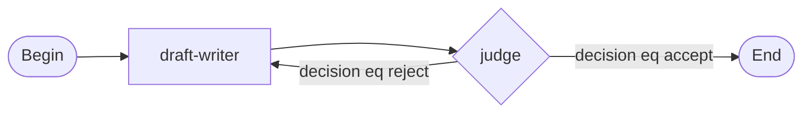

The Graph Builder is where you build and edit graphs. If you are new to graphs, start with the Graphs overview for the concepts (what a graph is, the superstep engine, graph sessions, and when to use one); this page is the hands-on walkthrough.

The builder is organised around three questions, and each has a place on screen:

- **What should this step do?** You add a step by choosing a purpose in plain language, not by picking a node type and configuring it afterwards.
- **Do its references still resolve?** A banner at the top says so. Values you pull from earlier steps are chips, and chips stay correct when a step is renamed.
- **Is this ready to run?** A readiness chip in the toolbar tells you, and tells you what is missing when it is not.

```ref:graphs/overview
What a graph is, how the superstep engine runs it, and when to reach for one.
```

## Configuration

### Creating a graph

1. Go to **Graphs** in the left nav and click **New graph**.
2. Fill in the modal:
   - **ID** (optional): a short slug like `blog-pipeline`. Leave blank and the backend generates one.
   - **Description**: a one-line label shown in the list view.
   - **Seed agent**: the agent that seeds the first worker node. The console creates a minimal skeleton: `Begin -> agent -> End`.
3. Click **Create**. The builder opens immediately.

### The layout

```embed:graph-canvas
```

Three regions, left to right.

**Steps** lists every step in the graph, in order. A step that branches shows its branches underneath it, each reading as a sentence: `done -> synth`, `otherwise -> search`, `after 6 loops -> synth`. A step that fans out shows its copy count, for example `x3`. **+ Add a step** sits at the bottom, and `Cmd-K` opens the same thing.

**The canvas** draws the graph in **bands**, one per superstep, labelled `STEP 1`, `STEP 2` and so on. The bands are the point: everything in one band runs at the same time, so the picture matches how the engine actually executes rather than just how the arrows are drawn. A fan-out is bracketed and annotated with what it does, for example `3 copies run at the same time`. **Connect steps** wires two steps together, and you can also drag from one step onto another to connect them in a single gesture. **Tidy up** re-lays out the graph. Drag the background to pan, use the wheel to zoom, and the controls include **Fit to view** and **1:1**.

**The inspector** on the right describes whatever is selected, and is where you configure it. Nothing selected reads `Pick a step on the canvas or in the list to see what it does`.

### Node kinds

| Kind | `kind` value | Purpose |
|---|---|---|
| Begin | `begin` | Entry point; receives the graph's initial input. Every graph needs exactly one. |
| End | `end` | Sink; renders the final output template. At least one must be reachable from Begin. |
| Agent | `agent` | Runs a stored agent with a configurable input template. The main workhorse. |
| Subgraph | `graph` | Delegates to another stored graph (recursive composition). |
| Fan-out | `fan_out` | Dispatches the current state to multiple downstream nodes in parallel. |
| Fan-in | `fan_in` | Waits for all parallel branches to finish and aggregates their outputs. |
| Tool call | `tool_call` | Calls a platform tool directly without an agent turn. |

The builder speaks in purposes rather than kinds, but the two line up directly: **Ask an agent** makes an `agent` step, **Run a tool directly** a `tool_call`, **Use another graph** a `graph`, **Split the work in parallel** a `fan_out` paired with its `fan_in`, and **Finish and return something** an `end`. You need the kinds when reading a graph's JSON or the API; you do not need them to build one.

The graph node types page (linked at the end of this page) documents the full configuration of each kind.

### Adding a step

Click **+ Add a step** (or press `Cmd-K`). The picker asks what should happen next, relative to the step you are on, and offers purposes rather than node types:

**Do work**

| Choice | What it means |
|---|---|
| **Ask an agent to do something** | Writes, reviews, decides. Anything that needs judgement |
| **Run a tool directly** | Fetch, write a file, call an API. No model, no cost |
| **Use another graph** | Reuse a pipeline you already built |

**Change the shape**

| Choice | What it means |
|---|---|
| **Split the work in parallel** | Per item in a list, or N copies. Adds the merge step too |
| **Choose between paths** | Send the run one way or another based on a result |
| **Finish and return something** | A graph can have several finishes |

Picking a purpose completes the step: choose the agent and the step is named after it, and it inherits the previous step's output. As the picker puts it, every step is created finished, so a half-built graph is not a state you can be in by accident.

```callout:tip
**Split the work in parallel** adds the merge step at the same time. A fan-out without its fan-in is a graph that cannot finish, so the builder does not let you create one by forgetting the second half.
```

### Configuring a step

Select a step, in the list or on the canvas, and the inspector asks three things:

- **Which agent** (or which tool, or which graph): a searchable, paged list with each candidate's description, so you are choosing on purpose rather than on id.
- **What it gets**, from earlier steps: the input, written as text with **chips** for values pulled from earlier steps. Type `/` or use **Insert** to add one. Chips are references, not text, so **they stay correct when a step is renamed**.
- **What it gives back**: free text by default. Add **fields** (or supply JSON) when a later branch needs to read this step's answer, since a branch can only test something structured.

Rename a step by editing its name at the top of the inspector. Every chip pointing at it follows.

### Connecting steps and branching

**Connect steps** on the canvas wires one step to another.

A step that chooses between paths shows its branches in the Steps list, each as a readable line: the condition, then the target. The first branch whose conditions hold fires. If none match and a default target is set, that fires instead; if none match and there is no default, the run ends failed.

```callout:warning
A fan-out step's downstream targets live on the step itself, not on ordinary connections out of it. Wiring a normal connection out of a fan-out is a topology violation and stops the graph being ready to run. Adding the split through **Split the work in parallel** sets this up correctly, and adds the merge step at the same time.
```

### `max_iterations`

Any graph whose edges can form a cycle must set `max_iterations`, a positive integer cap on how many supersteps the executor runs before it terminates the run with `ended_detail='max_iterations_exceeded'`. The builder enforces this: a graph with a cycle and no `max_iterations` is not ready to run, and the readiness chip says so.

Set the graph's `on_max_iterations` to a finalize step to land with output at the cap instead of hard-failing there. Without it, hitting the cap ends the run failed and whatever the graph had produced goes nowhere.

### References, readiness, and saving

Two indicators sit above the canvas and answer different questions.

**The references banner** reports whether everything the graph points at still exists and still resolves: the agents, the tools, the values steps pull from each other. `All references resolve` means nothing is dangling. This is the check that catches a step reading a field a renamed or deleted step no longer provides.

**The readiness chip** in the toolbar reports whether the graph can run at all. `Ready to run` means it can. When it cannot, the chip expands into what is missing, in the same plain language as the rest of the builder: **Add a start**, **Add a finish**, **Add fields**. Each comes with a **Show me** that takes you to the step in question, so the chip is a fix list rather than an error message.

Then:

- **Dry run** exercises the graph without starting a real session, so you find a broken reference before an agent does.
- **JSON** shows the underlying graph document, for when you would rather read or edit the source of truth directly.
- **Save draft** stores your changes. **Discard** reverts to the last saved version.

## Walkthrough: a producer-judge loop

This walkthrough builds the producer-judge loop from the quickstart: a draft-writer feeds a completeness-judge that either loops back or accepts the draft.

1. Open **Graphs** and click **New graph**. Name it `blog-pipeline`. Choose any agent as the seed.
2. The builder opens with a start, one agent step, and a finish. Select the agent step and pick your drafting agent; the step takes its name from the agent.
3. With that step selected, click **+ Add a step** and choose **Ask an agent to do something**. Pick your judge agent.
4. In the judge's **What it gives back**, add fields for `decision` (`"accept"` or `"reject"`) and an optional `feedback`. A branch can only test something structured, which is why free text is not enough here.
5. Select the judge and add a step with **Choose between paths**. Give it two branches: one where `decision` is `reject`, going back to the drafting step, and one where it is `accept`, going to the finish.
6. Select the finish and set what it returns, using **Insert** to drop in a chip for the drafting step's output rather than typing its name.
7. Set `max_iterations` to `10` in the graph's properties. The loop in step 5 makes this required.
8. Check the readiness chip reads **Ready to run**, click **Dry run** to confirm the references hold, then **Save draft**.



9. Start it from the workspace **Studio**: open the workspace, click `+` in the **Runs** rail, select `blog-pipeline` as the graph, and give it your initial topic as `graph_input`.

The run opens as a tab with its superstep strip, so you can watch each band complete as the engine advances.


```ref:graphs/graph-node-types
Every node kind: configuration fields, behavior, and examples.
```

```ref:graphs/graph-templating
How Jinja2 templates in nodes access upstream outputs and graph input.
```

```ref:workspaces/workspaces-and-sessions
How sessions are created, how graph_input is validated, and how runs are inspected.
```
